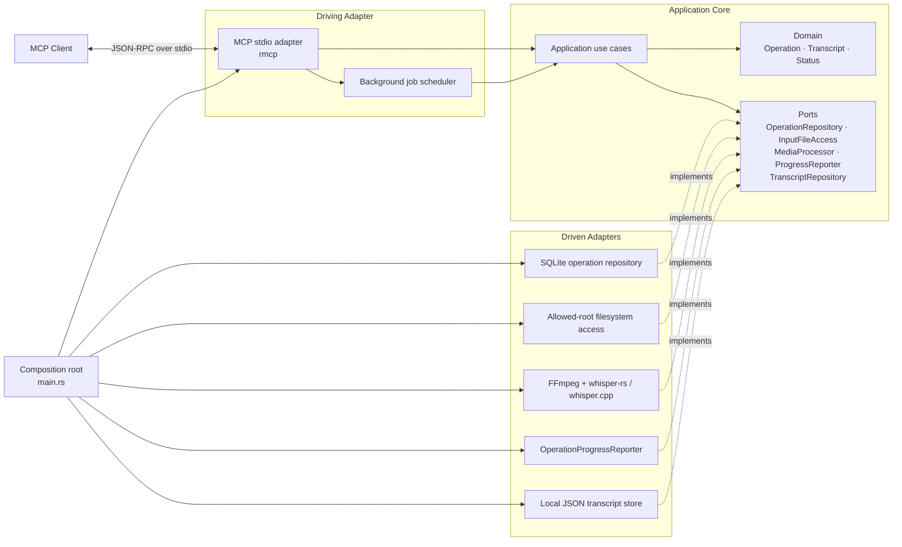
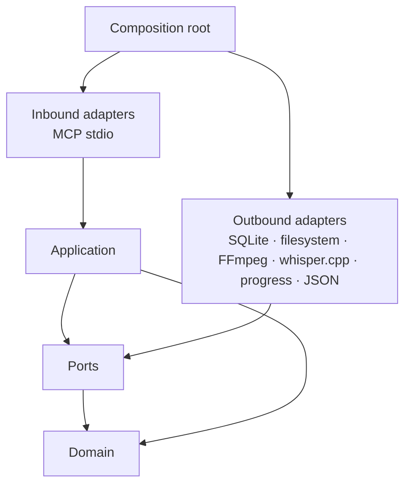

# Architecture

The application core describes use cases and depends on port traits. Concrete adapters implement those traits. `main.rs` is the composition root and the MCP server is the driving adapter.

## Dependency direction

The domain has no dependency on protocol or infrastructure libraries. The application layer uses ports and has no dependency on Tokio. The MCP adapter schedules synchronous use cases on a blocking worker, while media processing reports inference progress through the `ProgressReporter` port. The composition root chooses concrete implementations.

For transcription, the caller supplies `expected_format` (`mp3` or `mp4`). The application resolves the allowed file and asks the `MediaProcessor` adapter for container and audio-stream metadata from `ffprobe`. It compares the declaration with the extension and detected container before persisting or scheduling an operation. A discrepancy returns detailed diagnostics and stops the flow.

## Source map

- `src/domain.rs`: operation and transcript types.
- `src/ports.rs`: outbound contracts, including progress reporting.
- `src/application.rs`: application use cases and operation lifecycle.
- `src/adapters.rs`: SQLite, filesystem, media, progress-reporting, and transcript-store adapters.
- `src/adapters/mcp.rs`: MCP tool schemas, request/response mapping, and job scheduling.
- `src/main.rs`: configuration and dependency wiring.
